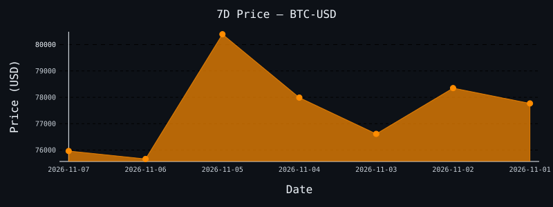
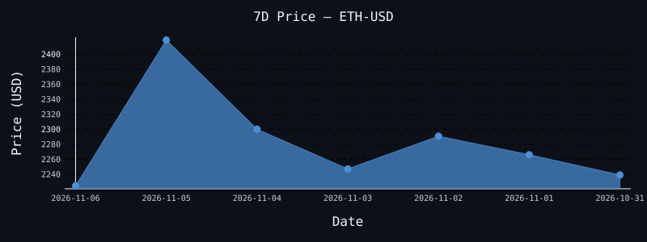
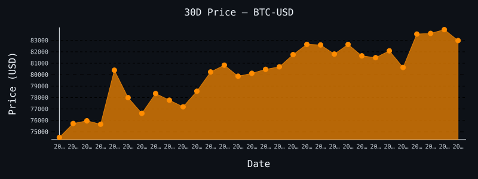
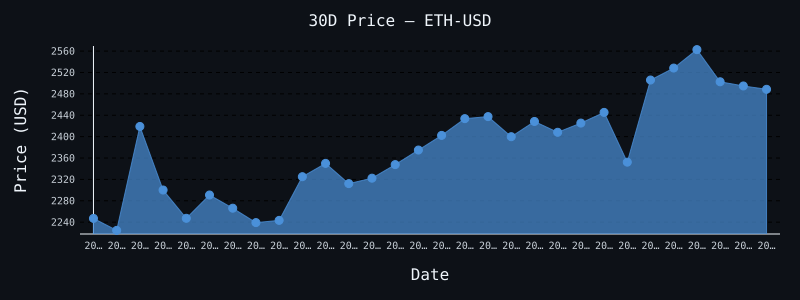
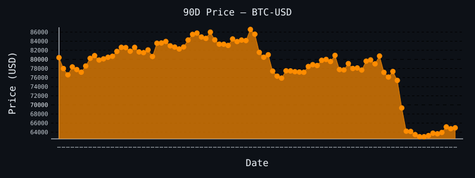
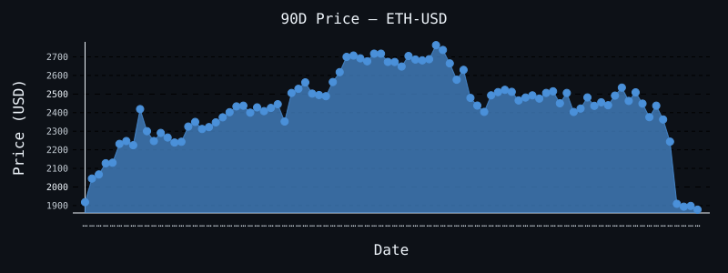
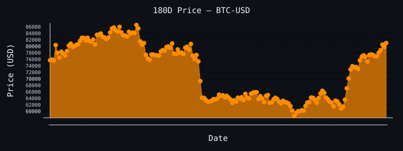
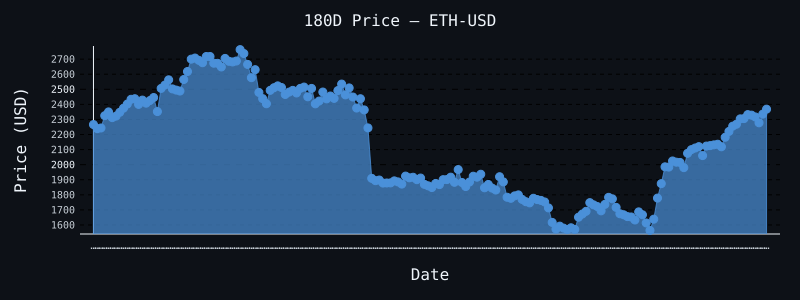
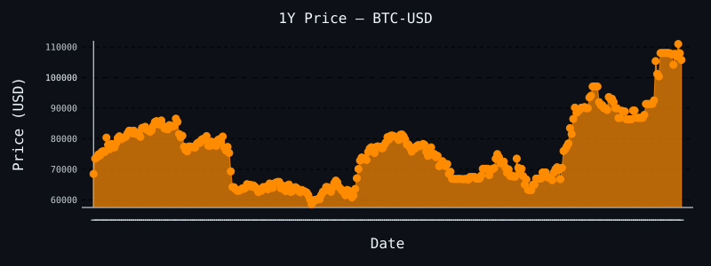
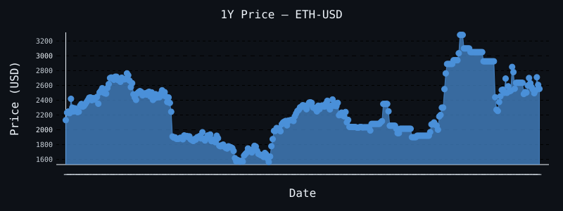

# Cryptocurrency Board

> Last updated: 2026-11-04 05:53 UTC

## Market Overview

| Coin | Price (USD) | 24h Change |
| ---- | ----------- | ---------- |
| **BTC** | **$77,989.00** | ▲ +1.8% |
| **ETH** | **$2,300.14** | ▲ +2.3% |

## 7-Day Dashboard

| Coin | Min | Max | Avg | Median | Return % | Volatility |
|------|-----|-----|-----|--------|----------|------------|
| **BTC** | $76,613.00 | $80,237.00 | $78,099.29 | $77,989.00 | -2.8% | 1.76% |
| **ETH** | $2,239.20 | $2,325.06 | $2,273.13 | $2,266.13 | -1.1% | 2.19% |

## 30D Dashboard

| Coin | Min | Max | Avg | Median | Return % | Volatility |
|------|-----|-----|-----|--------|----------|------------|
| **BTC** | $76,613.00 | $85,503.00 | $81,252.20 | $81,701.00 | -8.8% | 1.29% |
| **ETH** | $2,239.20 | $2,699.98 | $2,410.57 | $2,405.22 | -14.8% | 2.03% |

## 90D Dashboard

| Coin | Min | Max | Avg | Median | Return % | Volatility |
|------|-----|-----|-----|--------|----------|------------|
| **BTC** | $63,006.00 | $86,587.00 | $78,132.89 | $79,830.00 | +21.3% | 1.97% |
| **ETH** | $1,871.38 | $2,763.16 | $2,403.93 | $2,449.43 | +21.0% | 2.74% |

## 180D Dashboard

| Coin | Min | Max | Avg | Median | Return % | Volatility |
|------|-----|-----|-----|--------|----------|------------|
| **BTC** | $58,587.00 | $86,587.00 | $72,623.34 | $76,215.50 | -2.9% | 1.85% |
| **ETH** | $1,564.23 | $2,763.16 | $2,137.16 | $2,121.50 | -0.7% | 2.58% |

## 1Y Dashboard

| Coin | Min | Max | Avg | Median | Return % | Volatility |
|------|-----|-----|-----|--------|----------|------------|
| **BTC** | $58,587.00 | $111,000.00 | $77,039.44 | $76,916.00 | -26.8% | 2.16% |
| **ETH** | $1,564.23 | $3,282.87 | $2,270.16 | $2,277.82 | -10.8% | 2.99% |

---

## Deep Stats

### 1Y

| Coin    | Range %                                                 | Drawdown %                                                 |
| ------- | ------------------------------------------------------- | ---------------------------------------------------------- |
| **BTC** | 89.5% | 47.2% |
| **ETH** | 109.9% | 52.4% |

