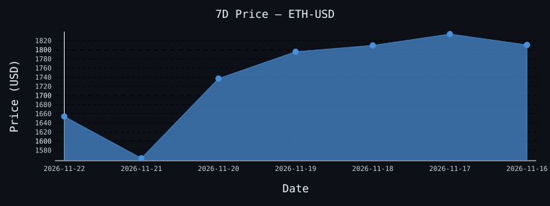

# Cryptocurrency Board

> Last updated: 2026-11-24 05:53 UTC

## Market Overview

| Coin | Price (USD) | 24h Change |
| ---- | ----------- | ---------- |
| **BTC** | **$60,584.00** | ▼ -1.7% |
| **ETH** | **$1,706.30** | ▼ -1.4% |

## 7-Day Dashboard

| Coin | Min | Max | Avg | Median | Return % | Volatility |
|------|-----|-----|-----|--------|----------|------------|
| **BTC** | $55,802.00 | $64,628.00 | $60,952.29 | $61,640.00 | -6.3% | 5.58% |
| **ETH** | $1,562.74 | $1,809.69 | $1,713.82 | $1,730.90 | -5.7% | 5.76% |

## 30D Dashboard

| Coin | Min | Max | Avg | Median | Return % | Volatility |
|------|-----|-----|-----|--------|----------|------------|
| **BTC** | $55,802.00 | $80,833.00 | $71,606.43 | $74,700.50 | -24.4% | 3.09% |
| **ETH** | $1,562.74 | $2,419.01 | $2,055.13 | $2,129.18 | -26.5% | 3.58% |

## 90D Dashboard

| Coin | Min | Max | Avg | Median | Return % | Volatility |
|------|-----|-----|-----|--------|----------|------------|
| **BTC** | $55,802.00 | $86,587.00 | $78,065.31 | $79,830.00 | -24.2% | 2.20% |
| **ETH** | $1,562.74 | $2,763.16 | $2,373.65 | $2,438.99 | -32.7% | 2.66% |

## 180D Dashboard

| Coin | Min | Max | Avg | Median | Return % | Volatility |
|------|-----|-----|-----|--------|----------|------------|
| **BTC** | $55,802.00 | $86,587.00 | $71,503.70 | $68,920.50 | -17.7% | 2.18% |
| **ETH** | $1,562.74 | $2,763.16 | $2,110.29 | $1,975.76 | -15.3% | 2.89% |

## 1Y Dashboard

| Coin | Min | Max | Avg | Median | Return % | Volatility |
|------|-----|-----|-----|--------|----------|------------|
| **BTC** | $55,802.00 | $108,044.00 | $74,952.08 | $75,031.00 | -43.9% | 2.27% |
| **ETH** | $1,562.74 | $3,282.87 | $2,236.19 | $2,219.03 | -35.2% | 3.04% |

---

## Deep Stats

### 1Y

| Coin    | Range %                                                 | Drawdown %                                                 |
| ------- | ------------------------------------------------------- | ---------------------------------------------------------- |
| **BTC** | 93.6% | 48.4% |
| **ETH** | 110.1% | 52.4% |

