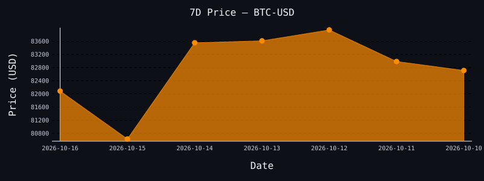
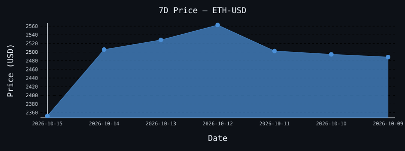
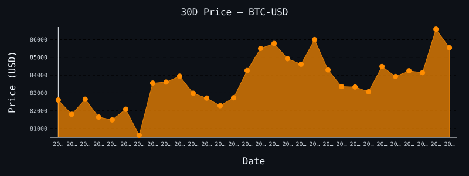
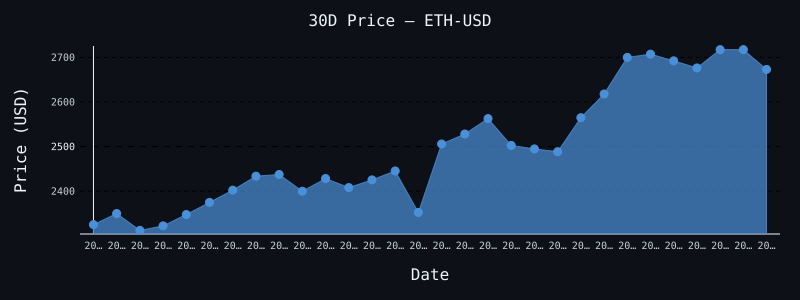
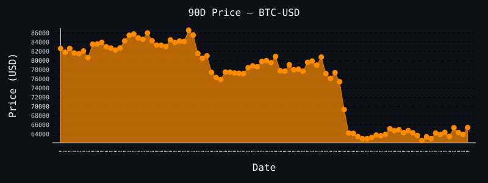
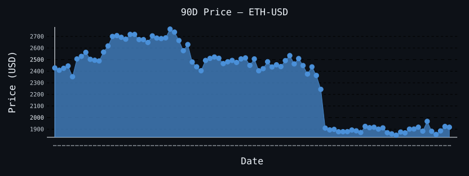
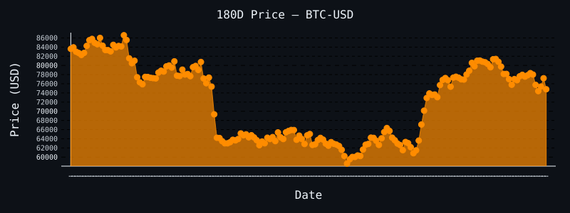
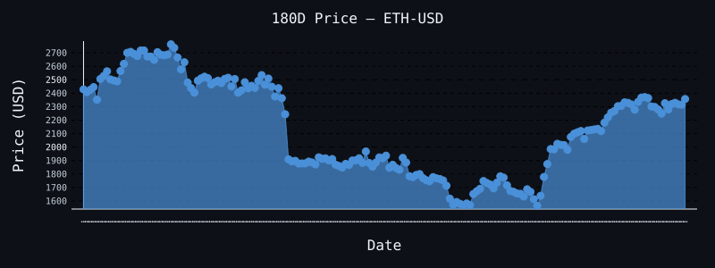
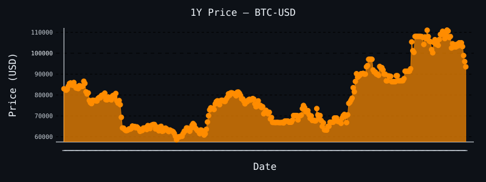
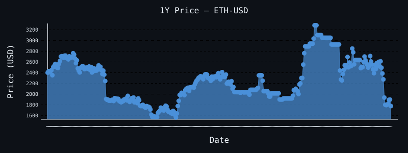

# Cryptocurrency Board

> Last updated: 2026-10-15 05:54 UTC

## Market Overview

| Coin | Price (USD) | 24h Change |
| ---- | ----------- | ---------- |
| **BTC** | **$80,630.00** | ▼ -3.5% |
| **ETH** | **$2,352.28** | ▼ -6.1% |

## 7-Day Dashboard

| Coin | Min | Max | Avg | Median | Return % | Volatility |
|------|-----|-----|-----|--------|----------|------------|
| **BTC** | $80,630.00 | $83,944.00 | $82,817.71 | $82,985.00 | -2.0% | 1.64% |
| **ETH** | $2,352.28 | $2,562.75 | $2,490.71 | $2,502.59 | -5.5% | 2.87% |

## 30D Dashboard

| Coin | Min | Max | Avg | Median | Return % | Volatility |
|------|-----|-----|-----|--------|----------|------------|
| **BTC** | $75,884.00 | $86,587.00 | $82,973.37 | $83,583.50 | +6.3% | 1.80% |
| **ETH** | $2,352.28 | $2,763.16 | $2,609.18 | $2,656.53 | -2.2% | 2.34% |

## 90D Dashboard

| Coin | Min | Max | Avg | Median | Return % | Volatility |
|------|-----|-----|-----|--------|----------|------------|
| **BTC** | $62,598.00 | $86,587.00 | $74,593.11 | $77,483.00 | +26.1% | 2.01% |
| **ETH** | $1,844.80 | $2,763.16 | $2,301.29 | $2,449.43 | +27.5% | 2.81% |

## 180D Dashboard

| Coin | Min | Max | Avg | Median | Return % | Volatility |
|------|-----|-----|-----|--------|----------|------------|
| **BTC** | $58,587.00 | $86,587.00 | $72,363.76 | $75,733.50 | +6.9% | 1.86% |
| **ETH** | $1,564.23 | $2,763.16 | $2,133.79 | $2,121.50 | +1.0% | 2.59% |

## 1Y Dashboard

| Coin | Min | Max | Avg | Median | Return % | Volatility |
|------|-----|-----|-----|--------|----------|------------|
| **BTC** | $58,587.00 | $111,065.37 | $78,478.24 | $76,962.00 | -23.2% | 2.19% |
| **ETH** | $1,564.23 | $3,282.87 | $2,254.02 | $2,240.88 | +31.4% | 3.21% |

---

## Deep Stats

### 1Y

| Coin    | Range %                                                 | Drawdown %                                                 |
| ------- | ------------------------------------------------------- | ---------------------------------------------------------- |
| **BTC** | 89.6% | 47.2% |
| **ETH** | 109.9% | 52.4% |

