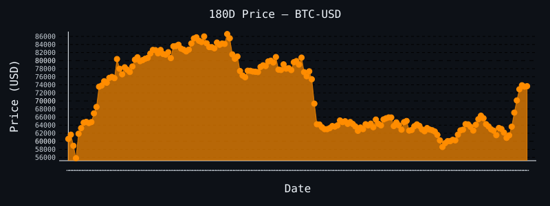
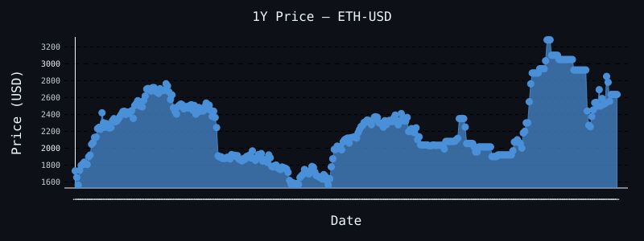

# Cryptocurrency Board

> Last updated: 2026-11-21 05:53 UTC

## Market Overview

| Coin | Price (USD) | 24h Change |
| ---- | ----------- | ---------- |
| **BTC** | **$55,802.00** | ▼ -9.8% |
| **ETH** | **$1,562.74** | ▼ -10.1% |

## 7-Day Dashboard

| Coin | Min | Max | Avg | Median | Return % | Volatility |
|------|-----|-----|-----|--------|----------|------------|
| **BTC** | $55,802.00 | $64,810.00 | $62,806.14 | $64,517.00 | -13.8% | 3.79% |
| **ETH** | $1,562.74 | $1,834.46 | $1,765.20 | $1,805.90 | -13.5% | 4.09% |

## 30D Dashboard

| Coin | Min | Max | Avg | Median | Return % | Volatility |
|------|-----|-----|-----|--------|----------|------------|
| **BTC** | $55,802.00 | $81,755.00 | $73,666.57 | $75,844.50 | -31.7% | 2.62% |
| **ETH** | $1,562.74 | $2,419.01 | $2,122.91 | $2,235.55 | -34.9% | 3.13% |

## 90D Dashboard

| Coin | Min | Max | Avg | Median | Return % | Volatility |
|------|-----|-----|-----|--------|----------|------------|
| **BTC** | $55,802.00 | $86,587.00 | $78,685.39 | $79,876.50 | -27.7% | 2.12% |
| **ETH** | $1,562.74 | $2,763.16 | $2,399.53 | $2,449.43 | -36.2% | 2.56% |

## 180D Dashboard

| Coin | Min | Max | Avg | Median | Return % | Volatility |
|------|-----|-----|-----|--------|----------|------------|
| **BTC** | $55,802.00 | $86,587.00 | $71,750.98 | $72,985.50 | -27.4% | 2.12% |
| **ETH** | $1,562.74 | $2,763.16 | $2,116.20 | $2,000.23 | -25.6% | 2.85% |

## 1Y Dashboard

| Coin | Min | Max | Avg | Median | Return % | Volatility |
|------|-----|-----|-----|--------|----------|------------|
| **BTC** | $55,802.00 | $108,044.00 | $75,343.94 | $75,395.00 | -48.4% | 2.23% |
| **ETH** | $1,562.74 | $3,282.87 | $2,243.49 | $2,231.91 | -37.1% | 3.03% |

---

## Deep Stats

### 1Y

| Coin    | Range %                                                 | Drawdown %                                                 |
| ------- | ------------------------------------------------------- | ---------------------------------------------------------- |
| **BTC** | 93.6% | 48.4% |
| **ETH** | 110.1% | 52.4% |

