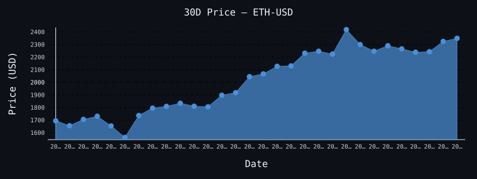

# Cryptocurrency Board

> Last updated: 2026-11-23 05:53 UTC

## Market Overview

| Coin | Price (USD) | 24h Change |
| ---- | ----------- | ---------- |
| **BTC** | **$61,640.00** | ▲ +4.7% |
| **ETH** | **$1,730.90** | ▲ +4.7% |

## 7-Day Dashboard

| Coin | Min | Max | Avg | Median | Return % | Volatility |
|------|-----|-----|-----|--------|----------|------------|
| **BTC** | $55,802.00 | $64,810.00 | $61,556.00 | $61,869.00 | -4.9% | 5.57% |
| **ETH** | $1,562.74 | $1,834.46 | $1,732.13 | $1,737.10 | -5.6% | 5.75% |

## 30D Dashboard

| Coin | Min | Max | Avg | Median | Return % | Volatility |
|------|-----|-----|-----|--------|----------|------------|
| **BTC** | $55,802.00 | $80,833.00 | $72,269.20 | $75,278.50 | -23.4% | 3.09% |
| **ETH** | $1,562.74 | $2,419.01 | $2,076.51 | $2,177.67 | -26.3% | 3.58% |

## 90D Dashboard

| Coin | Min | Max | Avg | Median | Return % | Volatility |
|------|-----|-----|-----|--------|----------|------------|
| **BTC** | $55,802.00 | $86,587.00 | $78,270.12 | $79,830.00 | -22.0% | 2.20% |
| **ETH** | $1,562.74 | $2,763.16 | $2,382.06 | $2,442.60 | -29.7% | 2.68% |

## 180D Dashboard

| Coin | Min | Max | Avg | Median | Return % | Volatility |
|------|-----|-----|-----|--------|----------|------------|
| **BTC** | $55,802.00 | $86,587.00 | $71,573.08 | $69,728.50 | -15.6% | 2.18% |
| **ETH** | $1,562.74 | $2,763.16 | $2,111.81 | $1,982.22 | -12.6% | 2.89% |

## 1Y Dashboard

| Coin | Min | Max | Avg | Median | Return % | Volatility |
|------|-----|-----|-----|--------|----------|------------|
| **BTC** | $55,802.00 | $108,044.00 | $75,082.11 | $75,359.00 | -42.9% | 2.26% |
| **ETH** | $1,562.74 | $3,282.87 | $2,238.74 | $2,220.43 | -34.3% | 3.04% |

---

## Deep Stats

### 1Y

| Coin    | Range %                                                 | Drawdown %                                                 |
| ------- | ------------------------------------------------------- | ---------------------------------------------------------- |
| **BTC** | 93.6% | 48.4% |
| **ETH** | 110.1% | 52.4% |

