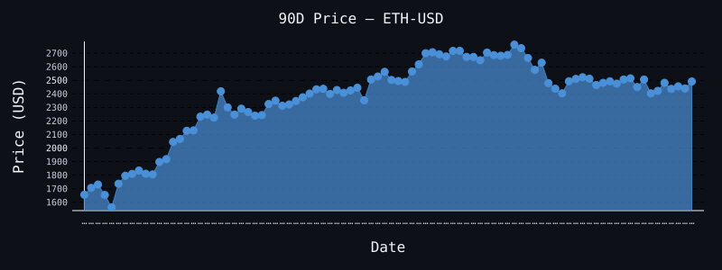

# Cryptocurrency Board

> Last updated: 2026-11-22 05:54 UTC

## Market Overview

| Coin | Price (USD) | 24h Change |
| ---- | ----------- | ---------- |
| **BTC** | **$58,881.00** | ▲ +5.6% |
| **ETH** | **$1,654.17** | ▲ +5.9% |

## 7-Day Dashboard

| Coin | Min | Max | Avg | Median | Return % | Volatility |
|------|-----|-----|-----|--------|----------|------------|
| **BTC** | $55,802.00 | $64,810.00 | $61,967.00 | $63,262.00 | -8.7% | 4.99% |
| **ETH** | $1,562.74 | $1,834.46 | $1,743.53 | $1,795.86 | -8.6% | 5.26% |

## 30D Dashboard

| Coin | Min | Max | Avg | Median | Return % | Volatility |
|------|-----|-----|-----|--------|----------|------------|
| **BTC** | $55,802.00 | $80,833.00 | $72,904.10 | $75,693.50 | -27.0% | 2.90% |
| **ETH** | $1,562.74 | $2,419.01 | $2,097.97 | $2,228.27 | -30.3% | 3.41% |

## 90D Dashboard

| Coin | Min | Max | Avg | Median | Return % | Volatility |
|------|-----|-----|-----|--------|----------|------------|
| **BTC** | $55,802.00 | $86,587.00 | $78,482.42 | $79,876.50 | -27.1% | 2.15% |
| **ETH** | $1,562.74 | $2,763.16 | $2,390.70 | $2,447.80 | -34.1% | 2.63% |

## 180D Dashboard

| Coin | Min | Max | Avg | Median | Return % | Volatility |
|------|-----|-----|-----|--------|----------|------------|
| **BTC** | $55,802.00 | $86,587.00 | $71,651.24 | $71,514.50 | -22.2% | 2.16% |
| **ETH** | $1,562.74 | $2,763.16 | $2,113.72 | $1,984.87 | -20.3% | 2.89% |

## 1Y Dashboard

| Coin | Min | Max | Avg | Median | Return % | Volatility |
|------|-----|-----|-----|--------|----------|------------|
| **BTC** | $55,802.00 | $108,044.00 | $75,209.24 | $75,380.00 | -45.5% | 2.25% |
| **ETH** | $1,562.74 | $3,282.87 | $2,241.22 | $2,224.63 | -37.2% | 3.03% |

---

## Deep Stats

### 1Y

| Coin    | Range %                                                 | Drawdown %                                                 |
| ------- | ------------------------------------------------------- | ---------------------------------------------------------- |
| **BTC** | 93.6% | 48.4% |
| **ETH** | 110.1% | 52.4% |

