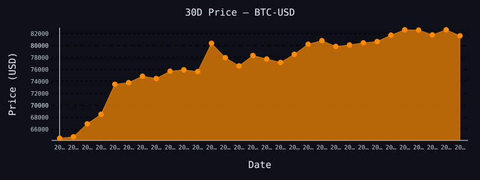

# Cryptocurrency Board

> Last updated: 2026-11-25 05:54 UTC

## Market Overview

| Coin | Price (USD) | 24h Change |
| ---- | ----------- | ---------- |
| **BTC** | **$59,050.00** | ▼ -2.6% |
| **ETH** | **$1,655.73** | ▼ -3.0% |

## 7-Day Dashboard

| Coin | Min | Max | Avg | Median | Return % | Volatility |
|------|-----|-----|-----|--------|----------|------------|
| **BTC** | $55,802.00 | $63,262.00 | $60,155.43 | $60,584.00 | -6.7% | 5.60% |
| **ETH** | $1,562.74 | $1,795.86 | $1,691.83 | $1,706.30 | -7.8% | 5.82% |

## 30D Dashboard

| Coin | Min | Max | Avg | Median | Return % | Volatility |
|------|-----|-----|-----|--------|----------|------------|
| **BTC** | $55,802.00 | $80,833.00 | $70,904.13 | $74,160.00 | -26.1% | 3.11% |
| **ETH** | $1,562.74 | $2,419.01 | $2,032.91 | $2,097.49 | -28.4% | 3.60% |

## 90D Dashboard

| Coin | Min | Max | Avg | Median | Return % | Volatility |
|------|-----|-----|-----|--------|----------|------------|
| **BTC** | $55,802.00 | $86,587.00 | $77,833.77 | $79,705.50 | -25.8% | 2.22% |
| **ETH** | $1,562.74 | $2,763.16 | $2,363.88 | $2,437.79 | -33.5% | 2.67% |

## 180D Dashboard

| Coin | Min | Max | Avg | Median | Return % | Volatility |
|------|-----|-----|-----|--------|----------|------------|
| **BTC** | $55,802.00 | $86,587.00 | $71,422.54 | $67,808.50 | -19.7% | 2.19% |
| **ETH** | $1,562.74 | $2,763.16 | $2,108.29 | $1,952.03 | -17.9% | 2.90% |

## 1Y Dashboard

| Coin | Min | Max | Avg | Median | Return % | Volatility |
|------|-----|-----|-----|--------|----------|------------|
| **BTC** | $55,802.00 | $108,044.00 | $74,817.85 | $75,000.00 | -45.3% | 2.27% |
| **ETH** | $1,562.74 | $3,282.87 | $2,233.51 | $2,200.00 | -37.2% | 3.05% |

---

## Deep Stats

### 1Y

| Coin    | Range %                                                 | Drawdown %                                                 |
| ------- | ------------------------------------------------------- | ---------------------------------------------------------- |
| **BTC** | 93.6% | 48.4% |
| **ETH** | 110.1% | 52.4% |

