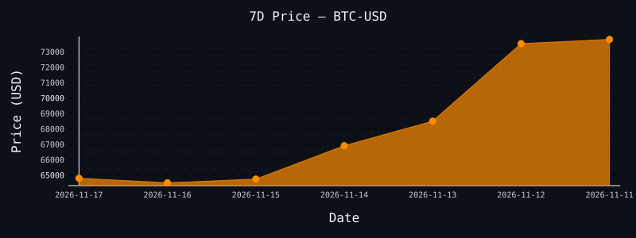
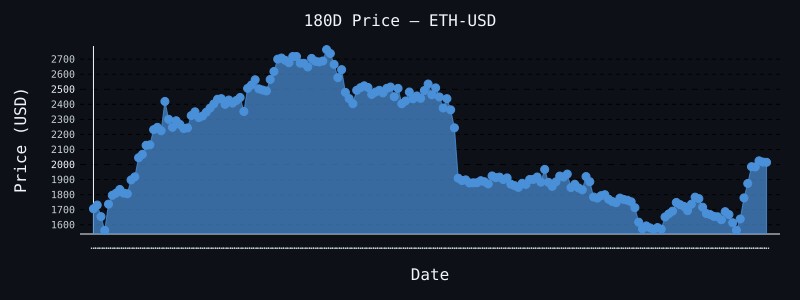

# Cryptocurrency Board

> Last updated: 2026-11-16 05:53 UTC

## Market Overview

| Coin | Price (USD) | 24h Change |
| ---- | ----------- | ---------- |
| **BTC** | **$64,517.00** | ▼ -0.3% |
| **ETH** | **$1,810.68** | ▲ +0.2% |

## 7-Day Dashboard

| Coin | Min | Max | Avg | Median | Return % | Volatility |
|------|-----|-----|-----|--------|----------|------------|
| **BTC** | $64,517.00 | $74,895.00 | $69,565.29 | $68,514.00 | -13.9% | 2.43% |
| **ETH** | $1,805.90 | $2,127.65 | $1,953.29 | $1,918.20 | -14.9% | 2.50% |

## 30D Dashboard

| Coin | Min | Max | Avg | Median | Return % | Volatility |
|------|-----|-----|-----|--------|----------|------------|
| **BTC** | $64,517.00 | $82,653.00 | $77,032.60 | $78,169.50 | -21.0% | 2.07% |
| **ETH** | $1,805.90 | $2,437.45 | $2,235.17 | $2,278.48 | -24.8% | 2.66% |

## 90D Dashboard

| Coin | Min | Max | Avg | Median | Return % | Volatility |
|------|-----|-----|-----|--------|----------|------------|
| **BTC** | $64,217.00 | $86,587.00 | $79,263.34 | $79,876.50 | +0.5% | 2.27% |
| **ETH** | $1,805.90 | $2,763.16 | $2,428.31 | $2,449.43 | -5.2% | 3.09% |

## 180D Dashboard

| Coin | Min | Max | Avg | Median | Return % | Volatility |
|------|-----|-----|-----|--------|----------|------------|
| **BTC** | $58,587.00 | $86,587.00 | $72,161.46 | $73,851.50 | -16.8% | 2.00% |
| **ETH** | $1,564.23 | $2,763.16 | $2,126.20 | $2,063.78 | -14.9% | 2.76% |

## 1Y Dashboard

| Coin | Min | Max | Avg | Median | Return % | Volatility |
|------|-----|-----|-----|--------|----------|------------|
| **BTC** | $58,587.00 | $108,044.00 | $75,958.08 | $75,786.00 | -39.7% | 2.18% |
| **ETH** | $1,564.23 | $3,282.87 | $2,255.00 | $2,243.85 | -31.1% | 3.00% |

---

## Deep Stats

### 1Y

| Coin    | Range %                                                 | Drawdown %                                                 |
| ------- | ------------------------------------------------------- | ---------------------------------------------------------- |
| **BTC** | 84.4% | 45.8% |
| **ETH** | 109.9% | 52.4% |

