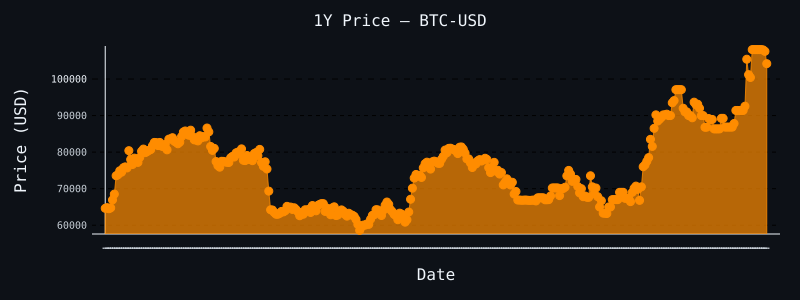

# Cryptocurrency Board

> Last updated: 2026-11-20 05:53 UTC

## Market Overview

| Coin | Price (USD) | 24h Change |
| ---- | ----------- | ---------- |
| **BTC** | **$61,869.00** | ▼ -2.2% |
| **ETH** | **$1,737.10** | ▼ -3.3% |

## 7-Day Dashboard

| Coin | Min | Max | Avg | Median | Return % | Volatility |
|------|-----|-----|-----|--------|----------|------------|
| **BTC** | $61,869.00 | $66,922.00 | $64,394.71 | $64,628.00 | -7.6% | 1.43% |
| **ETH** | $1,737.10 | $1,897.86 | $1,813.08 | $1,809.69 | -8.5% | 2.28% |

## 30D Dashboard

| Coin | Min | Max | Avg | Median | Return % | Volatility |
|------|-----|-----|-----|--------|----------|------------|
| **BTC** | $61,869.00 | $82,653.00 | $74,561.60 | $76,288.50 | -25.1% | 2.04% |
| **ETH** | $1,737.10 | $2,433.64 | $2,151.94 | $2,241.27 | -28.6% | 2.66% |

## 90D Dashboard

| Coin | Min | Max | Avg | Median | Return % | Volatility |
|------|-----|-----|-----|--------|----------|------------|
| **BTC** | $61,869.00 | $86,587.00 | $78,911.10 | $79,876.50 | -18.7% | 1.87% |
| **ETH** | $1,737.10 | $2,763.16 | $2,408.56 | $2,449.43 | -26.9% | 2.37% |

## 180D Dashboard

| Coin | Min | Max | Avg | Median | Return % | Volatility |
|------|-----|-----|-----|--------|----------|------------|
| **BTC** | $58,587.00 | $86,587.00 | $71,870.14 | $73,306.00 | -19.9% | 1.99% |
| **ETH** | $1,564.23 | $2,763.16 | $2,119.24 | $2,015.70 | -17.7% | 2.76% |

## 1Y Dashboard

| Coin | Min | Max | Avg | Median | Return % | Volatility |
|------|-----|-----|-----|--------|----------|------------|
| **BTC** | $58,587.00 | $108,044.00 | $75,486.84 | $75,662.00 | -42.7% | 2.17% |
| **ETH** | $1,564.23 | $3,282.87 | $2,246.08 | $2,232.37 | -30.8% | 2.99% |

---

## Deep Stats

### 1Y

| Coin    | Range %                                                 | Drawdown %                                                 |
| ------- | ------------------------------------------------------- | ---------------------------------------------------------- |
| **BTC** | 84.4% | 45.8% |
| **ETH** | 109.9% | 52.4% |

