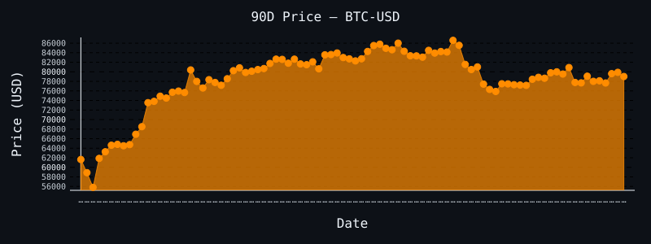

# Cryptocurrency Board

> Last updated: 2026-11-26 05:54 UTC

## Market Overview

| Coin | Price (USD) | 24h Change |
| ---- | ----------- | ---------- |
| **BTC** | **$60,773.00** | ▲ +2.9% |
| **ETH** | **$1,694.82** | ▲ +2.4% |

## 7-Day Dashboard

| Coin | Min | Max | Avg | Median | Return % | Volatility |
|------|-----|-----|-----|--------|----------|------------|
| **BTC** | $55,802.00 | $61,869.00 | $59,799.86 | $60,584.00 | -1.8% | 5.77% |
| **ETH** | $1,562.74 | $1,737.10 | $1,677.39 | $1,694.82 | -2.4% | 5.87% |

## 30D Dashboard

| Coin | Min | Max | Avg | Median | Return % | Volatility |
|------|-----|-----|-----|--------|----------|------------|
| **BTC** | $55,802.00 | $80,833.00 | $70,267.77 | $73,677.00 | -24.8% | 3.16% |
| **ETH** | $1,562.74 | $2,419.01 | $2,012.33 | $2,056.38 | -27.9% | 3.62% |

## 90D Dashboard

| Coin | Min | Max | Avg | Median | Return % | Volatility |
|------|-----|-----|-----|--------|----------|------------|
| **BTC** | $55,802.00 | $86,587.00 | $77,624.41 | $79,664.50 | -21.7% | 2.23% |
| **ETH** | $1,562.74 | $2,763.16 | $2,355.03 | $2,437.05 | -30.5% | 2.68% |

## 180D Dashboard

| Coin | Min | Max | Avg | Median | Return % | Volatility |
|------|-----|-----|-----|--------|----------|------------|
| **BTC** | $55,802.00 | $86,587.00 | $71,351.51 | $67,012.50 | -17.8% | 2.20% |
| **ETH** | $1,562.74 | $2,763.16 | $2,106.50 | $1,930.41 | -16.3% | 2.90% |

## 1Y Dashboard

| Coin | Min | Max | Avg | Median | Return % | Volatility |
|------|-----|-----|-----|--------|----------|------------|
| **BTC** | $55,802.00 | $108,044.00 | $74,688.34 | $74,895.00 | -43.8% | 2.28% |
| **ETH** | $1,562.74 | $3,282.87 | $2,230.93 | $2,196.76 | -35.7% | 3.05% |

---

## Deep Stats

### 1Y

| Coin    | Range %                                                 | Drawdown %                                                 |
| ------- | ------------------------------------------------------- | ---------------------------------------------------------- |
| **BTC** | 93.6% | 48.4% |
| **ETH** | 110.1% | 52.4% |

